# Acceptance evidence

How the solution meets the challenge statement, requirement by requirement: a screenshot wherever the requirement shows on screen, and the tests that check it. Sections follow the statement's numbering.

The screenshots come from `npm run acceptance` ([tests/acceptance/capture.spec.ts](../tests/acceptance/capture.spec.ts)). Chromium emulates an iPhone 15 with touch, upright (393 × 852 CSS pixels) and sideways (734 × 343, the browser's toolbars included), plus one desktop screen for the keyboard. The script runs the e2e build: the production bundle plus the read-only test bridge, which sets each scene up (seed, map, ships and a manual clock) and never changes a match once it runs. The published demo is <https://pirate-battle-nu.vercel.app/>.

## 1. Required stack

| Responsibility | Technology | Where |
| --- | --- | --- |
| Interface and menus | React 19 | `src/app`, `src/features`, `src/shared/ui` |
| Language | TypeScript in strict mode | `tsconfig.app.json`, `tsconfig.node.json` |
| Game rendering | PixiJS 8 | `src/game/rendering` |
| Remote state of the ranking and the history | TanStack Query | `src/features/leaderboards`, `src/features/registration` |
| HTTP client of the ranking and the history | Axios | `src/shared/api` |
| Mocks of those APIs | MSW 2, in development, tests and the published build | `src/mocks` |
| End-to-end and visual tests | Playwright | `tests/e2e`, `tests/visual` |

## 2. Gameplay

### Player and controls

**Required:** sail forward and turn both ways; a bow cannon with one shot; side cannons with three parallel shots, one command per side; limited health, lowered by enemy shots and by a Chaser's ram; movement inside the visible arena, never through islands. Keyboard and touch controls for moving, turning and firing, moving and firing at once, shown in the interface.

  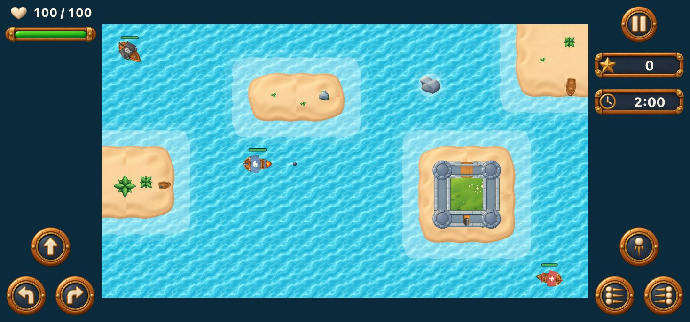

  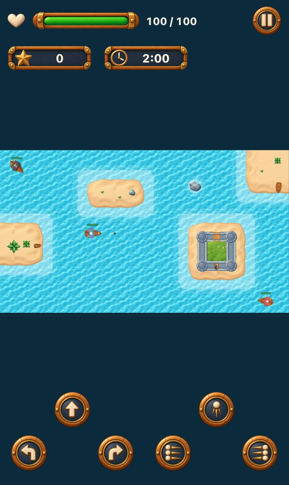
  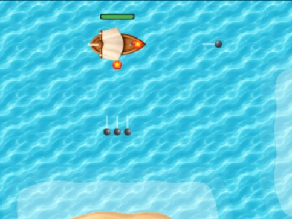

How to play explains the controls of the device in use: the on-screen buttons on a phone, the keys on a desktop.

  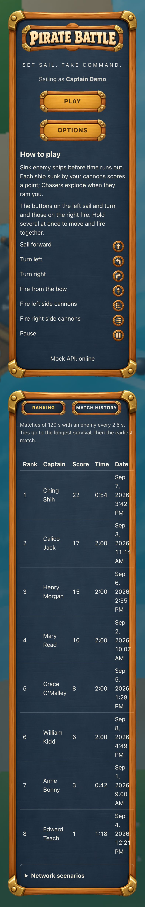
  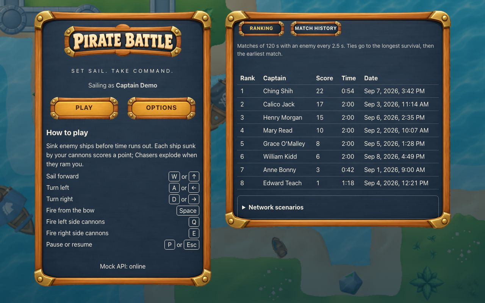

**Checked by:** `movement.spec.ts` (speeds, turning, arena bounds, sliding along an island), `map.spec.ts` (an island of a drawn map), `combat.spec.ts` (bow and side cannons, cooldowns, damage), `touch.spec.ts` (two fingers at once, each releasing only its action), `smoke.spec.ts` (the controls guide of each device).

### Enemies and spawns

**Required:** a Chaser that chases the player, damages it on contact and explodes; a Shooter that approaches and fires within range. Both sail, turn, take damage, respect islands and appear in a default match. Enemies spawn at the configured interval, on open water and far enough from the player.

The capture above shows both: the red Chaser and the black Shooter, each with its health bar. Enemy colors never change, so a glance tells who rams and who shoots.

**Checked by:** `combat.spec.ts` (Chaser ram, Shooter range and fire, the spawn interval), unit tests of `src/game/core` (spawns on reachable open water, far from the player, on the classic map and on drawn maps; navigation around islands).

### Arena, collisions and combat

**Required:** water and at least one island that blocks ships and projectiles; projectiles with direction, speed, damage and range; one hit per projectile; a cooldown per weapon; destroyed enemies stop acting.

Every match sails a new map drawn from its seed, always with several islands. Two of them:

  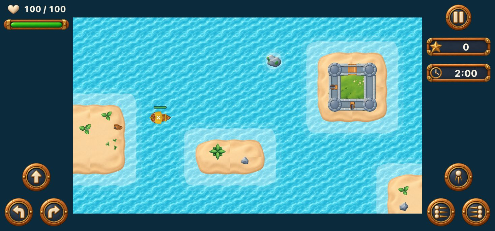
  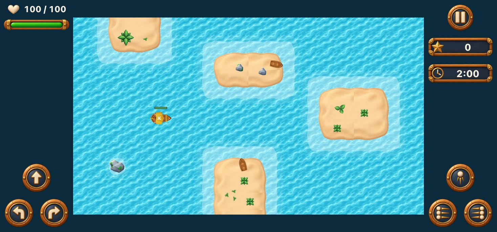

**Checked by:** `combat.spec.ts`, `movement.spec.ts`, `map.spec.ts`, and unit tests of collisions, projectiles and map generation (every rule of a layout over 300 seeds).

### Match rules, pause and feedback

**Required:** a duration between 60 and 180 s of active play; one point per enemy sunk by the player, none for a Chaser's ram; the match ends by time or death and then stops everything; a restart creates a new match. Health above every ship, score and remaining time in the HUD. Manual pause and automatic pause on losing focus or hiding the tab; the clock, cooldowns and simulation freeze, and resuming needs an action. Firing, destruction and damage give visible feedback.

  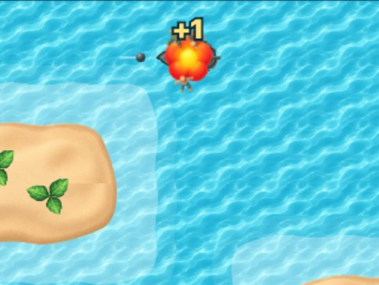
  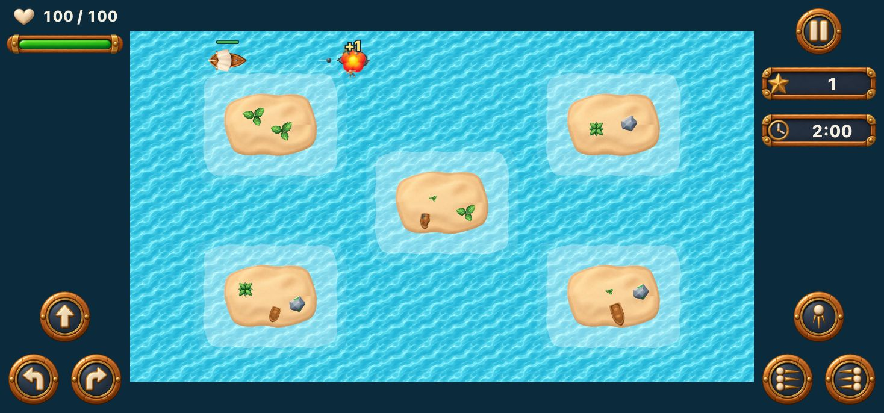

  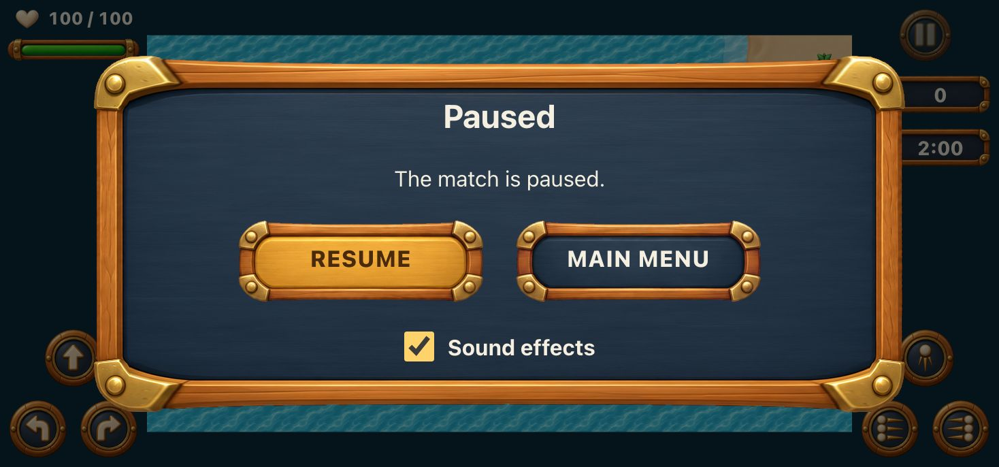
  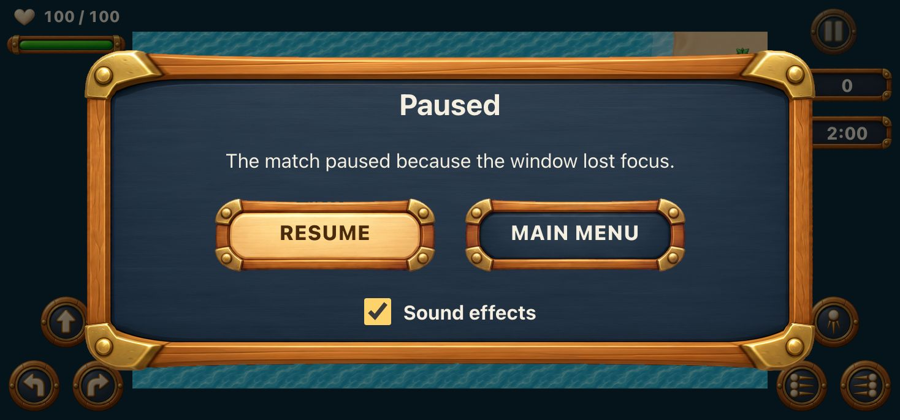

**Checked by:** `match-flow.spec.ts` (ends by time and by death, the simulation stopping, a clean restart, abandoning), `pause.spec.ts` (manual pause, lost focus, hidden tab, a frozen clock), `combat.spec.ts` (score without duplicates).

## 3. Screens and settings

| Screen | Required | Evidence |
| --- | --- | --- |
| Main menu | Play, Options, the controls and the Ranking and Match History tabs | `menu-phone.jpg` above |
| Options | Game session time and Enemy spawn time, validated, saved and kept after a reload | below |
| Match | PixiJS arena, HUD, controls and pause | section 2 |
| Result | Score, time played, end reason, registration status, Play Again and Main Menu | below |
| Ranking and Match History | Captains, scores, the player's matches, pages | section 5 |

  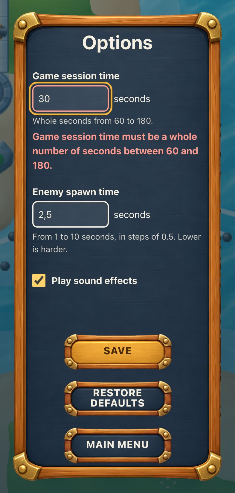
  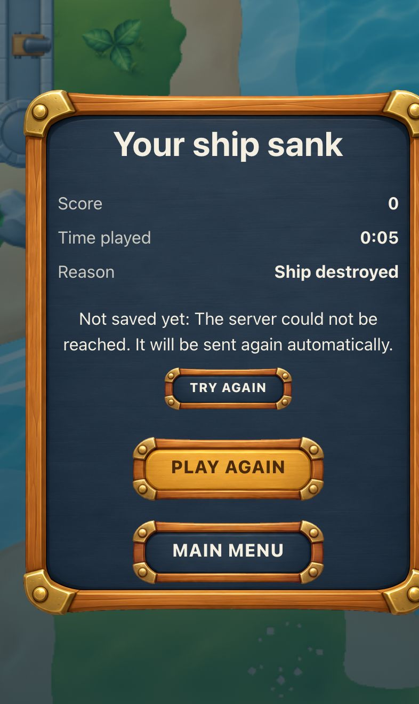

  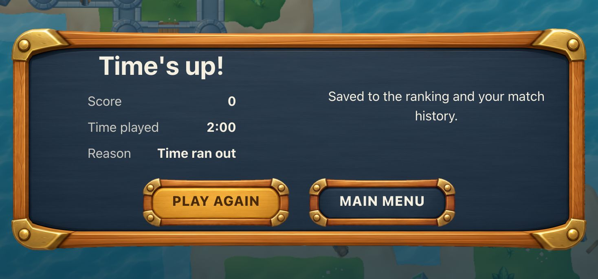

**Checked by:** `options.spec.ts` (navigation, validation, persistence), `registration.spec.ts` (the result and its persistence after a reload), `visual/screens.spec.ts` (baselines of the menu, the arena and the result).

## 4. PixiJS and architecture

**Required:** rules, rendering, input and interface state kept apart; time-based simulation; no React render per frame; textures loaded and reused, with failures handled before combat; the canvas fitted to the screen and its density; every resource released on exit or restart; correct mounting under React Strict Mode. [ARCHITECTURE.md](../ARCHITECTURE.md) describes each one.

Loading shows its progress, and a failed load stops before combat with Retry and Main Menu:

  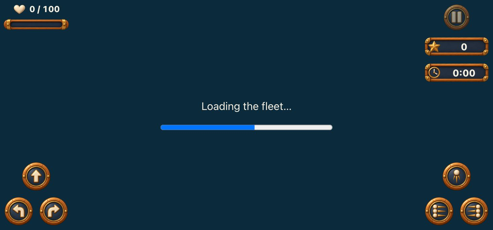
  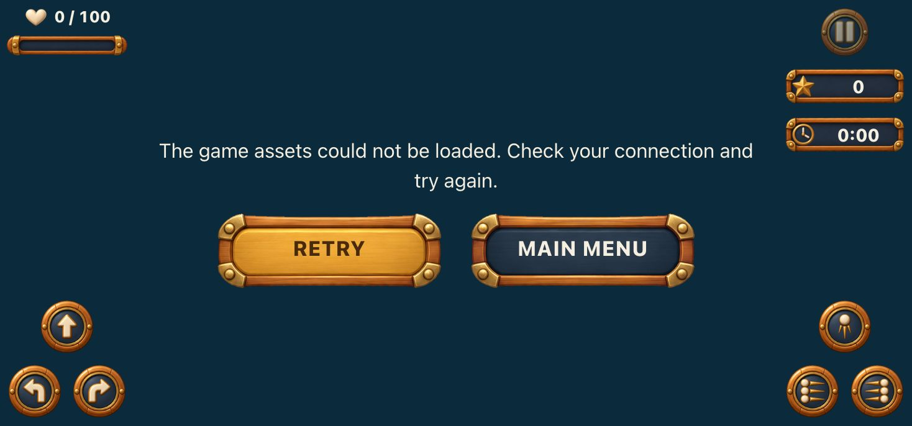

**Checked by:** `assets.spec.ts` (progress, failure, retry), `smoke.spec.ts` (one WebGL canvas per visit, removed on exit), the `dev-strict-mode` project (the whole suite under React Strict Mode) and the memory cycles of [PROFILING.md](PROFILING.md).

## 5. Ranking and match history

**Required:** a paginated ranking ordered by score, among matches of the same settings, with a deterministic tie-break; the player's paginated history; each record with match and player ids, date, score, duration, end reason and settings; one record per match, without duplicates on retries; pending records kept after failures or a reload; failures never blocking the game.

  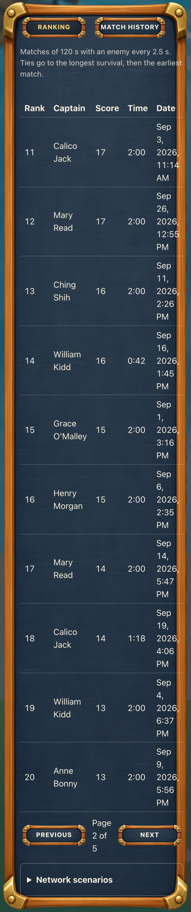
  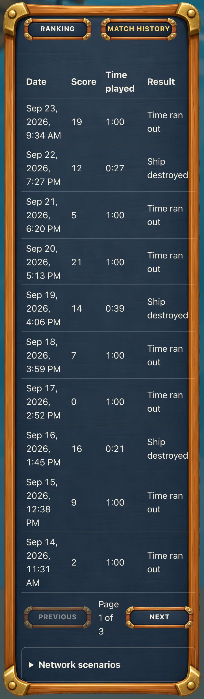
  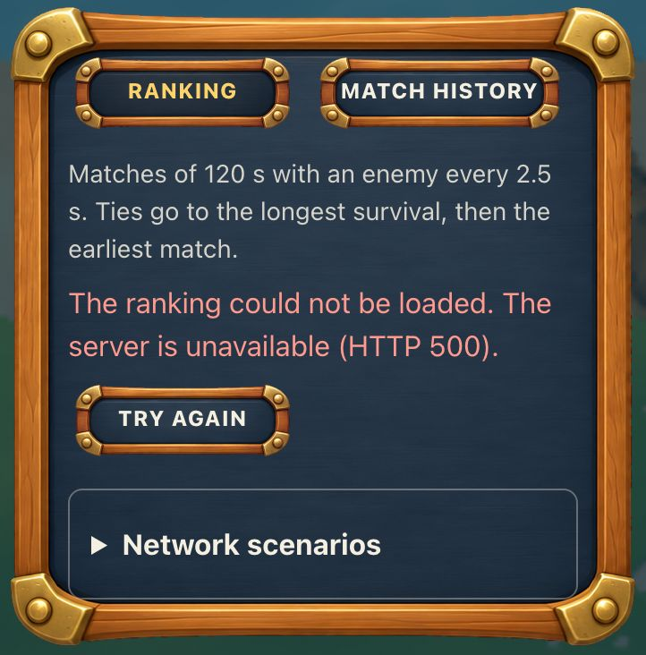

The result of a sunk ship above shows a registration waiting for the server: it is kept, sent again automatically and can be retried.

**Checked by:** `leaderboards.spec.ts` (pages, loading, empty and error states in both tabs), `registration.spec.ts` (both tabs updating, a pending registration surviving a reload, no duplicate after a timeout), `network-scenarios.spec.ts` (late answers never replacing newer data).

## 6. Mocking with MSW

**Required:** reproducible scenarios for success, empty lists and several pages; slowness, variable latency and out-of-order answers; timeouts, connection failures and HTTP 4xx/5xx; ranking or history failures; a timeout after registering; the server unavailable when a match ends. A way to pick a scenario and to reset; local persistence of confirmed and pending records; mocks working in the published build.

  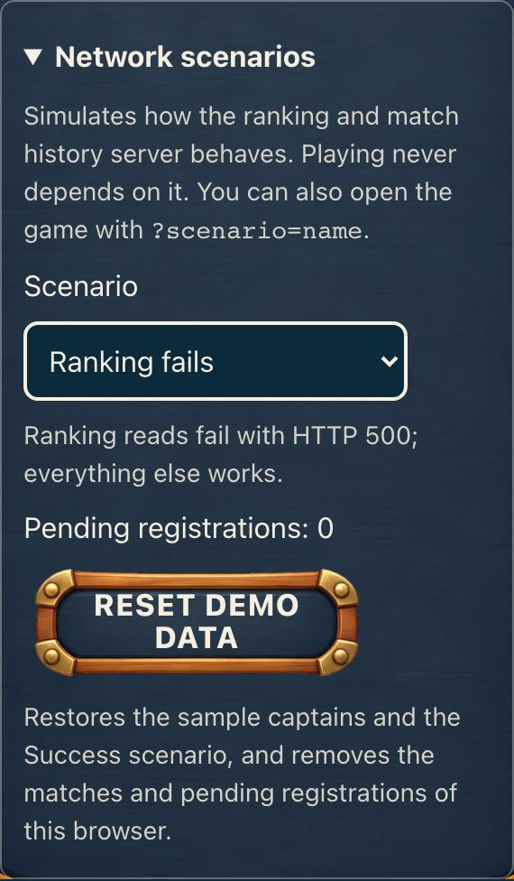

**Checked by:** `network-scenarios.spec.ts`, `leaderboards.spec.ts`, `registration.spec.ts`; the [README](../README.md#network-scenarios) lists every scenario and how to reproduce each failure.

## 7. Interface, assets and accessibility

**Required:** the provided assets as the visual base; desktop and mobile with usable touch controls and nothing cut from the arena or the HUD; a supported orientation and a layout that adapts without changing the rules; visible loading progress; keyboard navigation, visible focus, focus control in dialogs, labels, contrast and accessible errors; score, time and status in semantic markup; game keys captured only during play.

Every screen above comes from the asset pack. Phones play upright and sideways, the arena always whole and never covered. The menus, Options, a paused match and the result pass the axe checks of WCAG 2.1 A and AA.

**Checked by:** `touch-layout.spec.ts` (seven phone screens, both orientations, nothing overlapping, controls of at least 44 px), `accessibility.spec.ts` (axe, WCAG 2.1 A and AA), `options.spec.ts` (accessible errors), `pause.spec.ts` (focus in the dialog), `leaderboards.spec.ts` (tabs by keyboard).

## 8. Tests with Playwright

The twelve items of the statement's test list, the visual baselines on desktop and mobile, seeded scenarios with a controlled clock, isolated tests, the HTML report and failure traces: [TEST_REPORT.md](TEST_REPORT.md) maps each item to its specs and records the last full run.

## 9. Performance

Combat at 60 FPS in the optimized build, the 95th percentile frame time, entity counts over three minutes, and memory over five play-and-leave cycles: [PROFILING.md](PROFILING.md).

## 11. Delivery

| Required | Where |
| --- | --- |
| Source code, lockfile, assets, mocks, fixtures and tests | this repository |
| A public deploy running the mocks | <https://pirate-battle-nu.vercel.app/> (Vercel, from `main`) |
| README: setup, environment variables, controls, gameplay settings, network scenarios, commands, reproducing failures | [README.md](../README.md) |
| ARCHITECTURE: React and PixiJS, the simulation, collisions, resources, persistence, ranking and history, limitations and balancing | [ARCHITECTURE.md](../ARCHITECTURE.md) |
| Test and profiling reports | [TEST_REPORT.md](TEST_REPORT.md), [test-report/](test-report/index.html), [PROFILING.md](PROFILING.md) |
| Asset sources and licenses | [ASSET_LICENSES.md](ASSET_LICENSES.md) |

## Beyond the statement

None of these changes a rule the statement sets:

- every match draws its map from its seed, within rules that keep matches comparable;
- sinking ships throw their sailors overboard, and the point scored rises over the wreck;
- the player's sails take a new color each match, enemies keep theirs;
- rowboats lie on the beaches, and forts stand on grass islands;
- the ship creaks while it sails, and menu buttons sound;
- a hit shakes the scene, and the system's reduced motion setting stills the water, the leaps and the shake.
